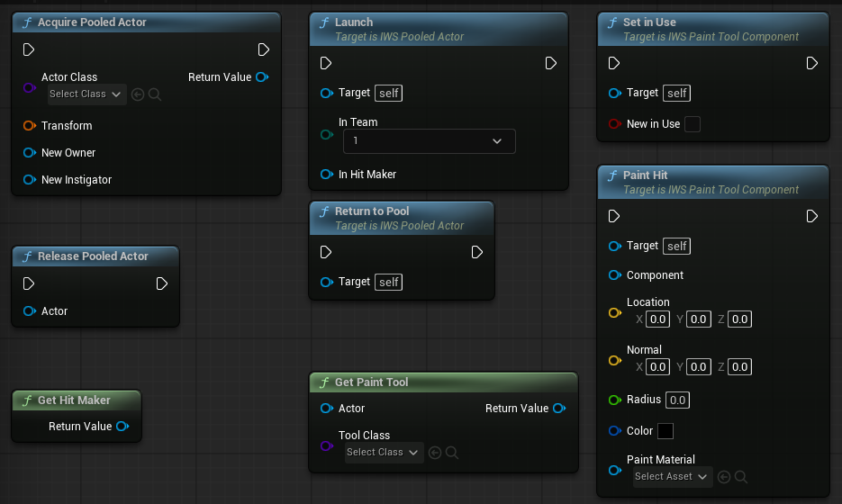

# Actor Pool

New in 2.0. Bullets and other actors that are made and thrown away often can be reused instead of spawned and destroyed. The demo bullets come from the pool.

  

## `IWS Actor Pool`

A world subsystem, there is nothing to place in the level.

| Node | Description |
| --- | --- |
| `Acquire Pooled Actor` | An actor of the class at the transform: one that went back to the pool, or a new one when the pool is empty. It comes visible, with collision and tick on, its projectile movement ready and the life span of its class. Server only for replicated actors. |
| `Release Pooled Actor` | Gives an actor back instead of destroying it: hidden, without collision, tick or life span, projectile movement stopped. A replicated actor only goes back to the pool on the server, clients see it hidden. |
| `Prewarm Actors` | Spawns a number of actors and puts them in the pool, so the first ones handed out do not cost a spawn. |
| `Get Pooled Count` | Actors of a class waiting in the pool. |

`Acquire Actor` and `Release Actor` do the same on a pool reference.

## `IWS Pooled Actor`

Base class for actors handed out again and again. They start with `Launch` instead of Begin Play, and end with `Return To Pool` instead of Destroy.

| Name | Description |
| --- | --- |
| `Launch` | Call on the server after `Acquire Pooled Actor` placed it. Runs `On Launch` on every machine with the same team and hit maker. |
| `On Launch` (event) | Set the actor up here, like at Begin Play. It may be an actor that already flew before. |
| `Return To Pool` | Gives the actor back to the pool. Only the server does it. |
| `Ignore Shooter When Moving` | At launch the root stops colliding with its owner, its instigator and what is attached to them, like the ink tank of a character. A shot collides from its first frame without hitting who fired it. |

## Using it for a bullet

1. Make the bullet a Blueprint child of `IWS Pooled Actor` (the demo uses `BP_IWS_PaintBullet_Type_01`).
2. Move its Begin Play setup to `On Launch`.
3. Where it was destroyed, call `Return To Pool`.
4. In the weapon, call `Acquire Pooled Actor` with the owner and instigator, set its variables, then call `Launch`.
