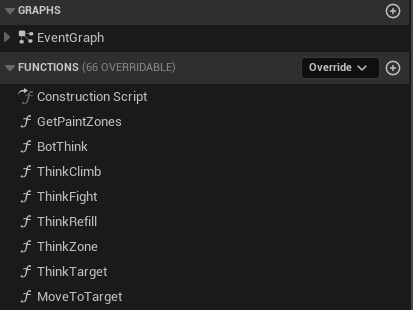
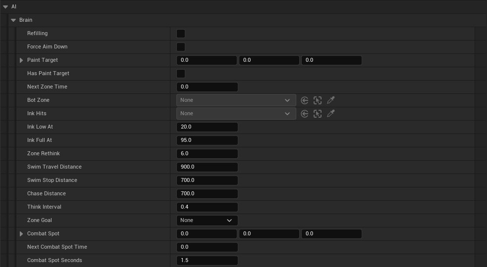
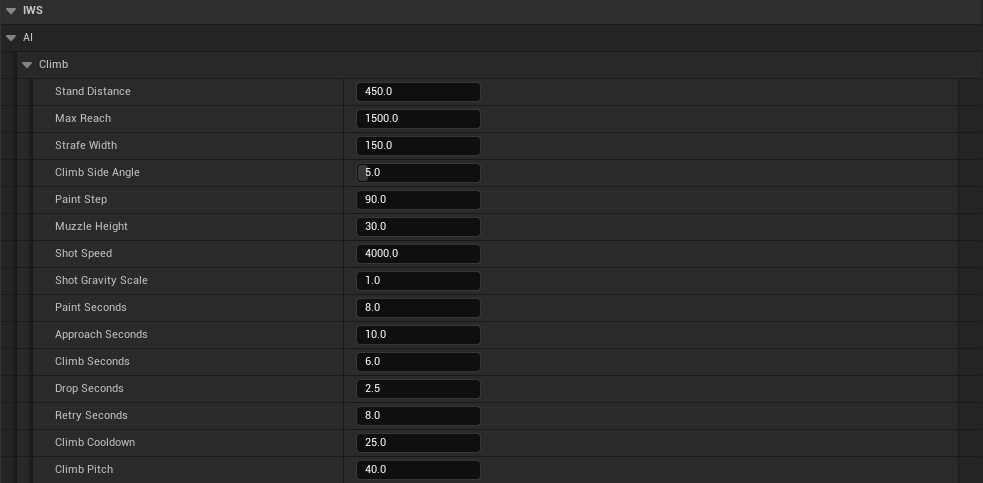
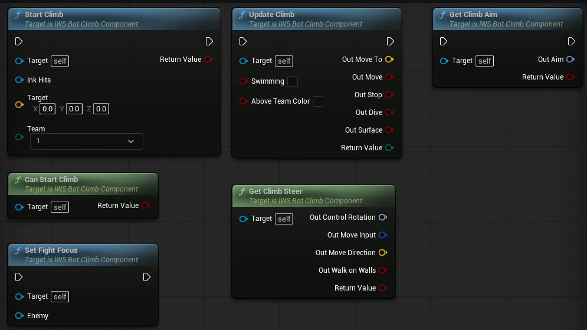
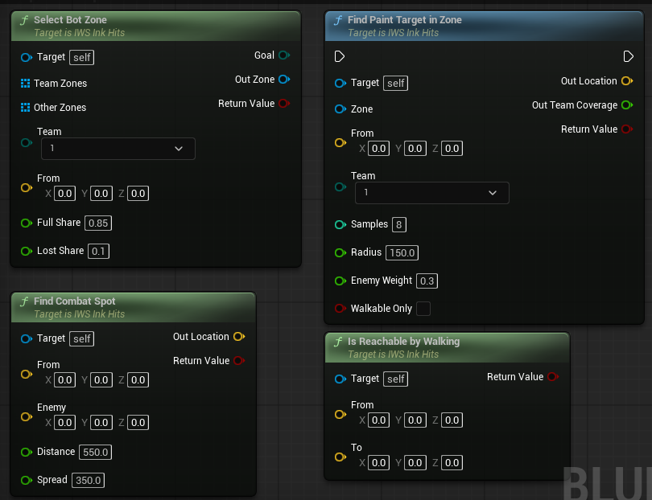

# Bots

The demo includes bots to fill teams and test the gameplay loop without a full lobby. Version 2.0 made them play like a player: they read the paint to decide where to go, fight, refill by swimming in their paint, and climb walls by painting them and swimming up.

They are still a demo and testing tool, not a complete production AI. The decisions live in the bot Blueprint, and the heavy work (reading the paint, finding spots, climbing) is in C++ functions that any Blueprint can call.

## How a bot thinks

`BP_InkWarfare_Bot` (child of `BP_InkWarfare_Player`) runs `Bot Think` every `Think Interval` seconds. The first case that applies runs:

  

| Function | When | What the bot does |
| --- | --- | --- |
| `Think Climb` | A climb is going on. | `Bot Climb` says where to walk, when to dive or surface and when to stop the path. The swim up the wall runs on Tick. |
| `Think Fight` | An enemy in sight, ink to spare, no refill. | Faces the enemy and moves to a new combat spot around it every `Combat Spot Seconds`, shooting while it moves. A swimming bot surfaces first. |
| `Think Refill` | Ink under `Ink Low At`, until `Ink Full At`. | Goes to the nearest team paint it can walk to and dives. With a little ink left and no paint nearby it shoots at its feet to make some. |
| `Think Zone` | Otherwise. | Every `Zone Rethink` seconds picks a zone with `Select Bot Zone`, then paints it. |
| `Think Target` | Inside `Think Zone`. | Picks the least painted point of the zone once the last one is reached. A target on a top starts a climb, a target below starts a drop. |
| `Move To Target` | Inside `Think Zone`. | Swims to far targets on team paint (from `Swim Travel Distance`), surfaces near the target and walks the rest. |

### Zones

Zones are `BP_IWS_ZoneCheck` actors: boxes placed over areas of the map, each with a `Team Zone`. `Get Paint Zones` collects the zones of the bot team and of the other teams. `Select Bot Zone` then picks, in order:

1. **Reclaim**: a team zone where the enemy painted `Lost Share` or more.
2. **Fill**: a team zone with less than `Full Share` of team paint. The demo bot calls a zone full at 15%, so it moves on to invade sooner.
3. **Invade**: a zone of the other team that is not full of the bot team paint.

Among zones of the same goal it picks at random, more often the ones that need more paint and the near ones.

### Climbing

Tops of rooms and boxes have navigation mesh too, but a bot can only reach them by swimming up a wall. `IWS Bot Climb Component` does it like a player: it walks away from the wall to see it, paints the floor at the foot and the wall up to the top, dives at the foot and swims up. To come down, bots use one-way jump links placed on the edges of every top. A bot starts a climb at most every `Climb Cooldown` seconds, so it spends most of its time on the floor.

## Bot variables

  

| Variable | Description |
| --- | --- |
| `Ink Low At` / `Ink Full At` | Ink percent that starts and ends a refill. |
| `Zone Rethink` | Seconds between two zone choices. |
| `Swim Travel Distance` / `Swim Stop Distance` | From what distance the bot swims to a target, and where it surfaces. |
| `Chase Distance` | How close the bot keeps to an enemy. |
| `Think Interval` | Seconds between two thinks. |
| `Combat Spot Seconds` | Seconds before moving to a new combat spot. |

The others in the category are runtime state (current zone, target, goal).

## Bot Climb Component

  

| Setting | Description |
| --- | --- |
| `Stand Distance` | How far from the wall the bot stands to paint it. |
| `Max Reach` | How far from the target the foot of the wall can be. |
| `Strafe Width` | The bot walks from side to side along the wall while it paints it, this far each way. |
| `Climb Side Angle` | Most the bot turns aside while swimming up, only to stay on its paint. |
| `Paint Step` | Height between the spots it shoots on the wall. |
| `Muzzle Height`, `Shot Speed`, `Shot Gravity Scale` | Used to aim at each spot. |
| `Paint Seconds`, `Approach Seconds`, `Climb Seconds`, `Drop Seconds` | Longest time of each stage before giving up. |
| `Retry Seconds` / `Climb Cooldown` | Wait after a failed climb, and between two climbs. |
| `Climb Pitch` | Pitch while swimming up. Looking up turns the move into the wall into a move up it. |

  

| Function | Description |
| --- | --- |
| `Start Climb` | Starts a climb up to a target on a top. Returns false when no wall leads there. |
| `Start Drop` / `Stop Climb` | Walk off the edge of a top toward a target below, or end the climb. |
| `Can Start Climb` | True when the cooldown and retry time passed. |
| `Update Climb` | Call at each think. Says where to walk (`Out Move To`), when to stop the path, dive or surface. Returns the stage. |
| `Get Climb Steer` | Call at each tick. While swimming up or dropping, returns the control rotation and move input a player would hold. |
| `Get Climb Aim` | While painting the wall, the aim for the next spot. |
| `Set Fight Focus` | With an enemy, the bot keeps facing it while it moves, so it can strafe and shoot. |
| `Get Stage`, `Is Climbing`, `Get Climb Target`, `Get Climb Route`, `Get Way Down` | State of the climb. |

## AI helpers of the hit maker

  

| Function | Description |
| --- | --- |
| `Select Bot Zone` | Picks the zone to paint, see above. |
| `Find Paint Target` / `Find Paint Target In Zone` | A reachable point of a box where the team has the least paint. Enemy paint counts as a better target than clean floor by `Enemy Weight`. |
| `Find Combat Spot` | A point the bot can walk to, around `Distance` from the enemy, on its side. |
| `Find Nearest Team Paint` | The nearest team paint where the bot can dive. |
| `Is Reachable By Walking` | True when the navigation mesh connects two points by walking. |
| `Find Climb Route` / `Is Climb Painted` | The wall that leads up to a target and whether it already has enough paint. |
| `Get Zone Paint` | Share of a zone floor held by each side. |

All of them read the CPU copy of the paint and need `Enable Paint Queries`.

## Map setup for bots

- A Nav Mesh Bounds Volume over the play area.
- `BP_IWS_ZoneCheck` actors over the areas each team should paint.
- One-way jump links (Nav Link Proxy) from the edges of tops down to the floor, so bots can come down.

## Recommended production approach

For a real game, treat the bots as a starting point. Replace or extend them with project-specific AI, behavior trees, EQS, perception, or custom combat logic. The C++ helpers above work from any of these.

The paint system itself is independent from the bot logic. Bots call the same `IWS Receive Impact` flow as players when their bullets hit paintable surfaces.
