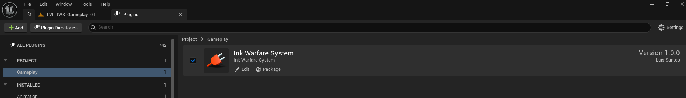

# Getting Started

> **Config reference**  
The demo config files used by the downloadable demo are included in `Demo/Config/DefaultEngine.ini` and `Demo/Config/DefaultEditor.ini`. Use them only as reference files when comparing the demo presentation with a clean Unreal Engine project, because Unreal's default project settings can produce a different visual result.

This guide explains the minimum setup required to understand and test the Ink Warfare System demo.

## Requirements

- Unreal Engine version supported by the Fab package.
- A project with the Ink Warfare System plugin enabled.
- At least one supported Static Mesh that should receive paint.
- UV channel 1 on paintable meshes.
- A material based on `M_IWS_DefaultAsset` or another material that uses the Ink Warfare material function.
- A gameplay object, projectile, weapon, or trace system that can call `IWS Receive Impact`, or a paint tool component that paints by itself.

## Basic setup flow

1. Enable the Ink Warfare System plugin.
2. Restart the editor when Unreal asks for it.
3. Place `BP_IWS_PS_InkHits` (or a child of it) in the level. This is the hit maker, the actor that owns the paint.
4. Make sure paintable meshes use the materials and setup expected by the system.
5. On hit, call `IWS Receive Impact` on the hit maker.
6. Pass the `Hit Result`, hit size, intensity, speed, team, and paint material.
7. Play the map and verify that the impact appears on the target mesh.

Gameplay classes can find the hit maker with `Get Hit Maker` (category `IWS|Demo`), which returns the `IWS_InkHits` actor of the level.

## Enable the plugin after download

When the plugin is installed from the Fab library, Unreal can import it with the plugin disabled by default. Open the **Plugins** window, find **Ink Warfare System**, enable it, and restart the editor when prompted.

## Demo maps

All maps are in `/InkWarfareSystem/Maps`.

| Map | What it is |
| --- | --- |
| `LVL_IWS_MainMenu` | Main menu. Host or join a session and pick the map. |
| `LVL_IWS_Lobby` | Lobby where players and bots are split into teams. |
| `LVL_IWS_Gameplay_01` | Ink battle: team turf war with bots. |
| `LVL_IWS_Demo_Spray` | Spray demo: first person spray cans with free colors. |
| `LVL_IWS_Demo_Cleaning` | Cleaning demo: a water hose that washes dirty surfaces. |
| `LVL_IWS_Transition` | Transition map used by seamless travel. |
| `LVL_IWS_DropTest` | Test map with `BP_IWS_DebugHitMaker`, which paints on a loop. Useful to tune splats and drips. |

## Main demo classes

| Class | Role |
| --- | --- |
| `BP_IWS_PS_InkHits` | Hit maker of the ink battle. Child of the C++ class `IWS_InkHits`. Holds the demo values for every paint setting. |
| `BP_IWS_PS_InkHits_Spray` / `BP_IWS_PS_InkHits_Cleaning` | Hit makers of the two tool demos, with float masks and their own resolution. |
| `BP_IWS_ZoneCheck` | Zone actor: a box that bots use to decide where to paint and that the game mode can score. |
| `BP_IWS_PaintDemoSetup` | Prepares the tool demos: fills tagged meshes, runs a material over the paint and spills water to the floor. |
| `GM_InkWarfare_Gameplay` / `GS_InkWarfare` | Game mode and game state of the ink battle. |
| `BP_InkWarfare_Player` / `BP_InkWarfare_Bot` | Player character and bot. |
| `BP_IWS_SprayCharacter` / `BP_IWS_HoseCharacter` | First person characters of the tool demos. |
| `GI_InkWarfare` | Game instance with the session, lobby and map flow. |

## Main C++ class

`IWS_InkHits` is the main C++ class used by the paint pipeline. It derives from `IWS_HitMaker`. It does not update the match rules by itself. It contains the paint functions, the replicated impact entry point, render-target utilities, radial-hit processing, paint queries, save and load, trails, drips and the helpers used by the bots.

The legacy Blueprint versions (`BP_IWS_MainHitMaker`, `BP_IWS_InkHits`) were removed in 2.0. Use `IWS_InkHits` or `BP_IWS_PS_InkHits`.

## Recommended learning order

1. Read [Painting System Overview](PaintingSystemOverview.md).
2. Read [IWS Receive Impact](IWSReceiveImpact.md).
3. Read [Ink Hits Classes](InkHitsClasses.md).
4. Read [Paint Queries](PaintQueries.md) to react to the paint in gameplay.
5. Read [Paint Tools and Demos](PaintToolsAndDemos.md) for color and amount masks.
6. Review [Optimization and Performance](OptimizationAndPerformance.md).
7. Open the demo Blueprint classes and compare them with the documentation.
