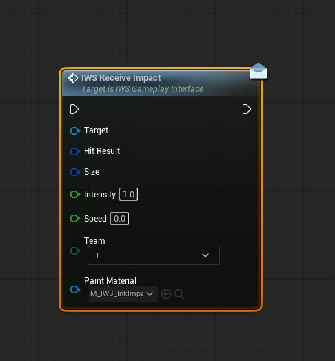

# IWS Receive Impact

`IWS Receive Impact` is the main Blueprint-facing entry point for sending a gameplay hit into the paint system.

  

## When to call it

Call `IWS Receive Impact` when a gameplay event should create paint. Common examples:

- Projectile impact.
- Weapon trace hit.
- Explosion splash.
- Ability impact.
- Character or object interaction that should paint a surface.

## Inputs

| Input | Description |
| --- | --- |
| `Target` | Object that implements the `IWS Gameplay Interface`. In the demo, this is usually the paint system actor. |
| `Hit Result` | The Unreal hit result produced by a trace, projectile, or collision event. It must contain a valid hit component. |
| `Size` | Hit size range. The X and Y values are used as the radius range during the paint animation. |
| `Intensity` | Initial hit strength. A value of `1.0` is normally a full-strength hit. |
| `Speed` | Animation speed for the radial hit. Higher values make the splash reach its final state faster. |
| `Team` | Team that owns the paint. The system maps teams to internal paint colors and score ownership. |
| `Paint Material` | Material used to draw the hit. Change this to customize the visual shape and behavior of each impact type. |

## Customizing the visual result

The most important customization point is the `Paint Material` input.

Different weapons can pass different materials while still using the same paint pipeline. For example:

- Standard ink shot material.
- Larger splash material.
- Soft radial stain material.
- Sharp paintball impact material.
- Special ability paint material.

The paint material receives runtime parameters from the C++ hit processor, including color, intensity, radius, hit position, hit normal, and unwrap texture. This means the same gameplay call can produce different visuals depending on the material passed to the node.

## Recommended usage pattern

A typical hit flow is:

1. Perform a line trace or receive a projectile hit.
2. Validate that the hit component is a paintable mesh.
3. Get a reference to the paint system actor.
4. Call `IWS Receive Impact`.
5. Pass the hit result, size, intensity, speed, team, and paint material.

## Notes

- The target should implement `IWS Gameplay Interface`.
- The paint material should be valid. Invalid paint materials are ignored by the optimized C++ path.
- The hit component should be a supported static mesh component.
- In multiplayer, impact registration is routed through the authority path and multicast registration.
