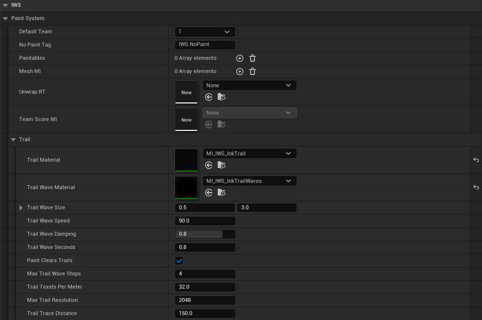

# Ink Hits Classes

This page describes the main classes used by the paint hit system.

## Class hierarchy

```txt
AActor
└── IWS_HitMaker          paint masks, unwrap capture, scores, paint queries, memory settings
    └── IWS_InkHits       radial hits, network, trails, drips, save/load, bot helpers, performance
        ├── BP_IWS_PS_InkHits            ink battle
        ├── BP_IWS_PS_InkHits_Spray      spray demo
        └── BP_IWS_PS_InkHits_Cleaning   cleaning demo
```

`IWS_RadialHits` is a thin child of `IWS_HitMaker` kept for compatibility.

## `IWS_InkHits`

`IWS_InkHits` is the main C++ class of the paint pipeline. It implements the `IWS Gameplay Interface`, so weapons call `IWS Receive Impact` on it.

It does not run the match by itself. It exposes the functions and utilities other classes need:

- Receive paint impacts and replicate them in compact batches.
- Send the paint that already exists to players who join late.
- Register static mesh components as paintables when they receive hits.
- Store and animate the active hits of each paintable.
- Create paint masks sized from the mesh surface and reuse unwrap captures.
- Draw hit materials into the masks, only where each hit can reach.
- Keep a CPU copy of the paint for queries and scores.
- Paint color hits, fill meshes, run materials over the paint and spill paint below walls.
- Save and load the paint of a level.
- Swim trails, drips and splats.
- Helpers for bots: zones, paint targets, combat spots, climb routes.
- Performance budgets and the `iws.Perf` report.

The variables are grouped in categories under `IWS`:

| Category | What it holds | Page |
| --- | --- | --- |
| `IWS|Paint System` | Default team, No Paint Tag, runtime paintable arrays. | [Painting System Overview](PaintingSystemOverview.md) |
| `IWS|Paint System|Trail` | Swim trail materials and waves. | [Trails, Splats and Drips](TrailsSplatsAndDrips.md) |
| `IWS|Radial Hits|Optimization` and `Distance` | Update budgets and view-based steps. | [Optimization and Performance](OptimizationAndPerformance.md) |
| `IWS|Radial Hits|Drips` | Paint running down walls. | [Trails, Splats and Drips](TrailsSplatsAndDrips.md) |
| `IWS|Paint Queries` | CPU copy of the paint. | [Paint Queries](PaintQueries.md) |
| `IWS|Network` | Hit batches and late join sync. | [Networking](Networking.md) |
| `IWS|Config` and `Config|Memory` | Materials, unwrap, mask format and sizes. | [Painting System Overview](PaintingSystemOverview.md) |

<p align="center">
  
</p>

## `BP_IWS_PS_InkHits`

`BP_IWS_PS_InkHits` is the hit maker placed in the ink battle map. It is a data-only child of `IWS_InkHits` that holds the demo values of every setting. For most users, this Blueprint is the best practical reference for how the paint system is configured in a playable project. Open it and check the `IWS` categories in **Class Defaults**.

`BP_IWS_PS_InkHits_Spray` and `BP_IWS_PS_InkHits_Cleaning` do the same for the tool demos, with `RTF_RGBA16f` masks and higher `Paint Texels Per Meter`.

## `BP_IWS_ZoneCheck`

`BP_IWS_ZoneCheck` is a zone actor: a box placed over an area of the map with a `Team Zone`. Bots read the paint inside each zone to decide where to go (`Select Bot Zone`), and the game mode can score the meshes inside it.

## Removed legacy classes

`BP_IWS_MainHitMaker`, `BP_IWS_InkHits` and `BP_IWS_RadialHits` were Blueprint versions of the first paint pipeline, kept in 1.x as reference. They were removed in 2.0. The C++ class keeps the same core formula.

## Runtime paintable data

Paintable meshes are stored as `ST_IWS_MeshPaint` entries containing component references, hit arrays, render targets, and score data.

A paintable entry can contain:

- Target primitive component and static mesh.
- Hit alpha values, speeds, locations, normals, sizes, teams and paint materials.
- Final-frame-only flags for distance optimization.
- Paint mask (impact render target).
- Unwrap render target and the unwrap origin.
- Trail texture.
- Capture dirty state and last captured transform.
- Team score data.

The hit arrays are processed together. When adding custom logic, keep these arrays aligned by index.

## Network behavior

`IWS Receive Impact` enters the C++ paint class:

- On the server, the hit is painted right away and queued for the next network batch.
- On a client, the hit is sent to the server, which paints it and adds it to the batch.
- Every `Hit Replication Interval` the server multicasts the batch, numbered in sequence, and every client paints the same hits.

See [Networking](Networking.md) for late joiners and resync.
