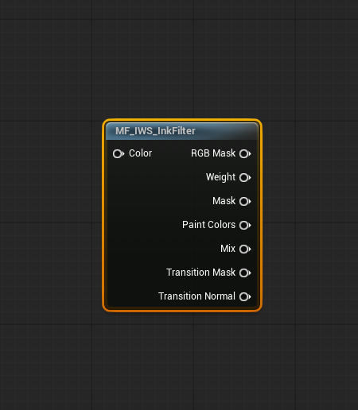

# Material Setup

Ink Warfare System is designed to let each project define its own final surface shader while keeping the paint filtering and team-color logic centralized.

The plugin includes a material function for the paint workflow, `MF_IWS_InkFilter`. It handles the internal filtering of the paint data and exposes outputs that can be used to build a shader that matches the visual style of the project.

<p align="center">
  
</p>

## Default demo material

The demo material `M_IWS_DefaultAsset` (and its instance `MI_IWS_DefaultAsset`) is the recommended reference for new integrations.

It shows how to use the material function outputs with a mesh material: paint color, ink normals, the relief between paint regions and the swim trail waves. When creating a custom material, use this material as the first reference before building a more complex shader.

## Main material function behavior

`MF_IWS_InkFilter` reads the paint mask and prepares the paint information for the final material.

The most important output for standard materials is `Mix`. It blends the received base color with the paint colors of the teams.

Typical usage:

1. Start with the asset's normal base color.
2. Pass it to the `Color` input of `MF_IWS_InkFilter`.
3. Use the `Mix` output as the base color.
4. Continue building the rest of the material normally, such as roughness, normal, and other visual effects.

## Important parameter: `RT_Damage`

Inside the material function, the most important texture parameter is:

```txt
RT_Damage
```

This is the render target parameter name that the paint system sets on every painted mesh.

If you duplicate or recreate the material function, keep this exact parameter name. Renaming it will break the default lookup expected by the system.

`RT_Damage` must be sampled using **UV channel 1**, because UV 1 is the unwrap channel used by the paint system.

## Swim trail texture: `RT_Trail`

Meshes with swim trails also receive a second texture parameter:

```txt
RT_Trail
```

Red is the height of the paint pushed by a swimmer. `MF_IWS_WaveNormal` turns it into a tangent space normal, and `M_IWS_DefaultAsset` exposes `Trail Depth` and `Trail Max Slope` to control how deep the waves look and how far they can tilt the surface. Sample it with UV channel 1 too. See [Trails, Splats and Drips](TrailsSplatsAndDrips.md).

## Material function outputs

`MF_IWS_InkFilter` outputs:

| Output | Use |
| --- | --- |
| `RGB Mask` | Raw paint mask: red, green and blue are team 1, 2 and 3. |
| `Weight` | Total paint on the pixel, the sum of the three channels. |
| `Mask` | Grayscale paint mask (luminance of the RGB mask, clamped to 0..1). |
| `Paint Colors` | The team colors from `MPC_IWS_TeamColors` weighted by each channel. `InkDarken` scales them. |
| `Mix` | `Color` where there is no paint plus `Paint Colors` where there is. The main output. |
| `Transition Mask` | Height of the paint, lowered into a groove where two teams meet. |
| `Transition Normal` | Tangent space normal of that height, for the relief and the grooves. |

The relief is controlled by the `Ink Filter` parameters of the material: `Mixer_PaintHeight`, `Mixer_GrooveDepth`, `Mixer_GrooveSize`, `Mixer_EdgeStrength`, `Mixer_NormalStrength` and `Mixer_Contrast`.

Not every material needs to use every output. A simple material can use only `Mix`, while a more stylized material can use the extra masks to create stronger ink borders, wetness, grooves, roughness changes, or custom effects. The groove width follows the texel size of the mask, so it stays the same on masks of any size, and pixels without paint skip the neighbor samples.

## Other material functions

| Function | Use |
| --- | --- |
| `MF_IWS_PaintBump` | Raises the surface where there is paint. Inputs: coverage, height in cm and the normal to blend with. Used by the spray surfaces. |
| `MF_IWS_WaveNormal` | Normal of the swim trail waves stored in `RT_Trail`. |
| `MF_IWS_TriplanarTexture` / `MF_IWS_TriplanarSix` / `MF_IWS_ObjectAlignedTexture` | Surface detail projected in world or object space, so it does not depend on the mesh UVs. They only sample the planes a pixel uses. |
| `MF_IWS_WaterNormal` / `MF_IWS_WaterFlowTap` | Water surface and flow of the cleaning demo. |
| `MF_IWS_SplatCapsule`, `MF_IWS_SplatDroplet`, `MF_IWS_SplatLobe`, `MF_IWS_InkSplash` | Shapes used by the battle splat `M_IWS_InkImpact`. |

## Surface materials of the tool demos

| Material | Mask meaning |
| --- | --- |
| `M_IWS_ColorPaintSurface` (spray) | RGB is the paint color, alpha is how much paint covers the texel. Uses `MF_IWS_PaintBump` for the relief. |
| `M_IWS_DirtySurface` (cleaning) | Red is dirt, green is water depth, blue is moving water. |

See [Paint Tools and Demos](PaintToolsAndDemos.md).

## Team colors material parameter collection

Team colors are centralized in:

```txt
MPC_IWS_TeamColors
```

This Material Parameter Collection is updated by the Game State at the beginning of the match. It receives the active colors for the teams and becomes the central point used by systems that need to read the current match colors.

Examples of systems that may use this collection:

- Player materials.
- Paintable asset materials.
- UI materials.
- VFX materials.
- Gameplay feedback materials.

Changing this Material Parameter Collection directly affects visuals that read from it, but it does not directly change gameplay rules. Gameplay ownership, score, and team logic are still driven by the gameplay systems.

To understand the demo flow that defines which color each team uses, check the Begin Play logic in:

```txt
GS_InkWarfare
GM_InkWarfare_Gameplay
```

## Creating a custom surface material

Recommended workflow:

1. Duplicate `M_IWS_DefaultAsset`.
2. Keep `MF_IWS_InkFilter` connected.
3. Keep the `RT_Damage` parameter name unchanged.
4. Make sure the render target is sampled with UV channel 1.
5. Replace or expand the base material logic to match the project art direction.
6. Use the `Mix` output for the first working version.
7. Add extra outputs, the trail normal or the paint bump only after the base paint behavior is confirmed.

## Creating a custom paint (hit) material

A hit material is drawn into the mask, it is not applied to a mesh. Start from `M_IWS_RadialImpact`:

1. Read the unwrap position from `Unwrap_Tex` and add `UnwrapOrigin` to get the world position of the texel.
2. Compare it with `Position` and `Radius` to build the shape.
3. Multiply by `Color` and `Intensity`.

The full parameter list is in [Painting System Overview](PaintingSystemOverview.md#paint-material). If the shape reaches further than `Radius`, raise `Hit Bounds Scale` on the hit maker so it is not cut.

## Practical notes

The paint material used by an impact can be customized through the impact call. This allows different projectiles or gameplay effects to use different paint visuals while still using the same paint system.

For most projects, the default `M_IWS_DefaultAsset` graph is the safest starting point.
