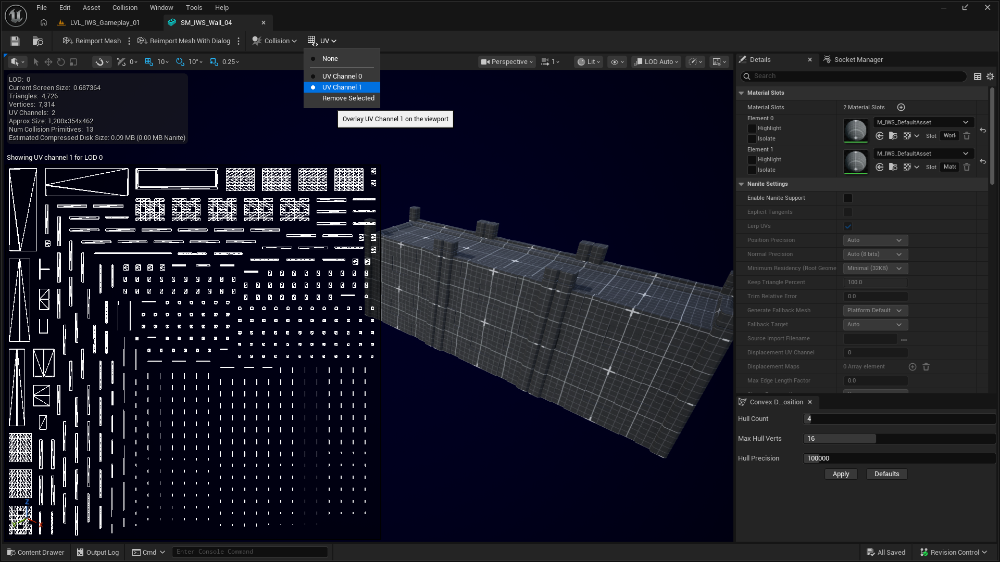

# Mesh Setup

This page explains how to prepare meshes for the Ink Warfare System paint workflow.

## Supported mesh type

The paint system is designed for supported **Static Mesh** assets.

Current limitations:

- Nanite meshes do not have full support in the default paint workflow. They may work in some cases, but the way Unreal Engine recalculates Nanite geometry at runtime can cause issues during the paint bake step, which may create inconsistencies in the final visual result.
- Skeletal Mesh components are not supported by the default paint workflow.
- The mesh must use a material that reads the paint render target through the Ink Warfare material function.

For reliable results, use regular Static Mesh assets with Nanite disabled on paintable surfaces. If a mesh paints inconsistently, first verify that it is a regular Static Mesh, that Nanite is disabled, and that the material is using the Ink Warfare material function correctly.

## UV channel requirement

By default, paintable meshes must have **UV channel 1**.

<p align="center">
  
</p>

UV channel 1 is used by the system as the unwrap channel for the paint capture and render-target workflow.

In most Unreal Engine projects, UV channel 1 is already generated as the lightmap UV channel. This usually makes the setup close to plug-and-play, because Unreal's generated lightmap UVs normally contain separated islands suitable for this type of unwrap workflow.

## Why UV 1 is important

The main purpose of using UV channel 1 is to make the paint target independent from the visible material layout.

This is especially important for assets that use multiple material slots. With the UV 1 workflow, the asset can be painted using a single paint mask for the whole mesh, instead of requiring one paint texture per material slot.

In practice, this means:

- One paint mask represents the paint state of the asset.
- Assets with multiple material slots can still share the same paint data.
- The visible materials can remain customized for the project.
- The paint layer is driven by the unwrap data instead of the visible UV layout.

## Mask size per mesh

Each mesh gets a square mask sized from the surface of its bounding box, so a small prop does not use the same texture as a large floor:

```txt
side = sqrt(surface area in m2) x Paint Texels Per Meter / 1.41
rounded up to a power of two, clamped to Min/Max Paint Resolution
```

`Compute Paint Resolution` returns the size a mesh gets. If paint looks blurry on a large mesh, raise `Paint Texels Per Meter` or `Max Paint Resolution` on the hit maker. If memory is high, lower them. The spray demo uses `256` texels per meter for fine lines, the battle uses `64`.

## Meshes that start painted

`Fill Paintable` gives a mesh its mask right away and fills it with a color. `Fill Actors With Tag` does it for every static mesh of the actors with a tag. Use it for surfaces that start painted, like the dirty walls of the cleaning demo, or to avoid the capture cost on the first hit during gameplay. `BP_IWS_PaintDemoSetup` calls it on the actors tagged `IWS.Paintable`.

## Meshes left out of the paint

Add the tag `IWS.NoPaint` (the `No Paint Tag` of the hit maker) to the actor `Tags`, or to the `Component Tags` of a single mesh. Hits on it are ignored and it never gets a paint mask. Use it for glass, props that should stay clean, or meshes without a usable UV 1.

## Recommended mesh checklist

Before testing an asset, verify:

1. The asset is a Static Mesh.
2. Nanite is disabled for the asset when consistent paint baking is required.
3. The mesh has UV channel 1.
4. UV channel 1 has valid separated islands.
5. The mesh material uses the Ink Warfare material function.
6. The mesh does not have the `IWS.NoPaint` tag.
7. The gameplay hit calls `IWS Receive Impact` with a valid hit result.

## Common issues

### The mesh does not paint

Check that the mesh has UV channel 1, that the material uses the expected paint render target parameter, and that the actor or component is not tagged `IWS.NoPaint`.

### Paint appears on unexpected parts of the mesh

Check the UV channel 1 unwrap. Overlapping islands can cause different surface areas to share the same paint data.

### Only some material slots seem to react

Make sure every visible material slot that should show paint uses the Ink Warfare material function or an equivalent shader setup.

### Paint is blurry or blocky

The mask of that mesh is too small for its size. Raise `Paint Texels Per Meter` or `Max Paint Resolution`, or split a very large floor into a few meshes.
