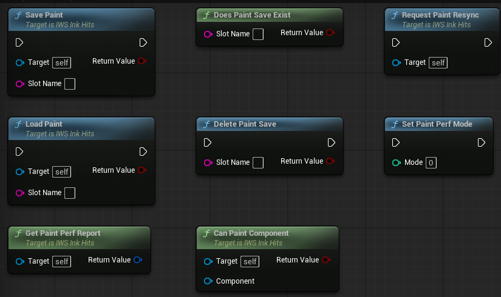

# Networking

The paint is replicated as hits, not as textures. Every machine paints the same hits in the same order and ends with the same paint. Version 2.0 made the hits smaller, grouped them, and added a sync for players who join late.

## How a hit travels

1. `IWS Receive Impact` is called on the hit maker. On a client it goes to the server first.
2. The server paints the hit and stores it as an `ST_IWS_NetHit`: component, quantized point and normal, size, intensity, speed, team, paint material and an optional color. A few bytes instead of a full hit result.
3. Every `Hit Replication Interval` seconds the server sends all new hits in one multicast, numbered in sequence.
4. Each client paints them. Effects that every machine can compute by itself, like drips, cost nothing on the network.

Paint tools (spray, hose) send their hits to the server in batches too, once per frame, through an unreliable call.

## Late joiners

With `Sync Paint To Late Joiners` on, the server keeps the hits of the match (up to `Max Hit History`, oldest dropped first). When a player joins, the server spawns an `IWS_PaintSyncProxy` owned by that player and sends the old hits only to it, `History Hits Per Chunk` hits per message, `History Chunks Per Second` messages per second.

The new player:

- Holds new hits until the old ones arrive, so everything is painted in order.
- Paints the old hits at their final size in `History Replay Steps` growing steps, so they leave the same marks the animation left for the others.
- Spends at most `Max History Draws Per Update` draws per update on them.
- Shows new hits anyway after `History Sync Timeout` seconds if the history does not arrive.

Swim trails are local and are not sent to late joiners.

## Resync and status

  

| Node | Description |
| --- | --- |
| `Request Paint Resync` | Client only. Clears the local paint and asks the server for every hit again, the same way a late joiner gets them. |
| `Get Last Hit Number` | Number of the last hit this machine knows. On the server the last hit made, on a client the last one received. |
| `Get Pending Sync Hits` | Client only. Hits received that are still waiting to be painted. A client is up to date when its last hit number matches the server and this is 0. |

## Settings

The settings are in the `IWS|Network` category of the hit maker (see the picture in [Paint Queries](PaintQueries.md#settings)).

| Variable | Description |
| --- | --- |
| `Hit Replication Interval` | Seconds of hits grouped into one message. `0` sends each hit right away. |
| `Sync Paint To Late Joiners` | Keeps the hits of the match and sends them to players who join later. |
| `Max Hit History` | Most hits kept for late joiners. `0` means no limit. |
| `History Hits Per Chunk` | Hits per history message. |
| `History Chunks Per Second` | History messages per second. |
| `History Sync Timeout` | Client. Seconds to wait for the history before showing new hits anyway. |
| `History Replay Steps` | Client. Growing steps used to paint each old hit. |
| `Max History Draws Per Update` | Client. Draw budget per update for old hits. |

## Notes

- The hit maker must be replicated and always relevant, like `BP_IWS_PS_InkHits`.
- The unwrap and team score render targets are no longer replicated, every machine makes its own.
- Characters only call server events they own: the ground check runs for the local player or on the server, bot aim and rotation run on the server.
- Paint that is saved with `Save Paint` is local to the machine that saved it.
