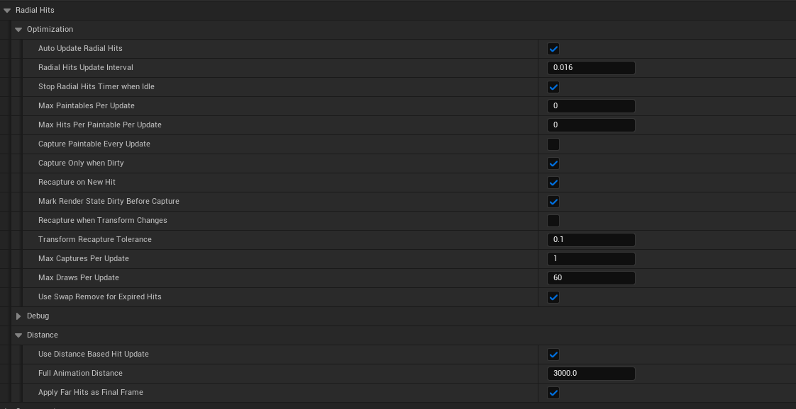

# Optimization and Performance

The optimized C++ paint path exposes several variables under the `Radial Hits` category. These settings control how often the paint system updates, how many hits are processed per update, and how often mesh surface data is captured.

  

## Optimization variables

| Variable | Description | Performance note |
| --- | --- | --- |
| `Auto Update Radial Hits` | Automatically updates radial hits with a timer. | Disable only if another system calls `Update Radial Hits` manually. |
| `Radial Hits Update Interval` | Time in seconds between automatic updates. `0.016` is close to 60 updates per second. `0.033` is close to 30 updates per second. | Lower values are smoother but more expensive. |
| `Stop Radial Hits Timer when Idle` | Stops the timer when no active hits are waiting to be processed. | Recommended for most projects. Saves CPU when no paint is animating. |
| `Max Paintables Per Update` | Maximum number of paintable meshes processed per update. `0` means no limit. | Use a positive value to spread work across frames. |
| `Max Hits Per Paintable Per Update` | Maximum number of active hits processed for each paintable per update. `0` means no limit. | Useful when many shots hit the same mesh. |
| `Capture Paintable Every Update` | Captures the paintable surface every update before drawing hits. | Safest but expensive. Usually disabled. |
| `Capture Only when Dirty` | Captures only when the paintable is marked dirty or requires a new capture. | Recommended for performance. |
| `Recapture on New Hit` | Marks the target paintable as dirty when a new hit is registered. | Useful when the surface capture must be refreshed before drawing. |
| `Mark Render State Dirty Before Capture` | Forces the mesh render state to update before capture. | Helps avoid stale material/transform data, but has a cost. |
| `Recapture when Transform Changes` | Recaptures when the mesh transform changes beyond the tolerance value. | Enable for moving paintable meshes. Disable for static level geometry. |
| `Transform Recapture Tolerance` | Minimum transform difference required before recapture. | Higher values reduce recaptures on very small movement. |
| `Max Captures Per Update` | Maximum number of surface captures allowed per update. `0` means no limit. | One of the most important performance controls. |
| `Max Draws Per Update` | Maximum number of `Draw Material to Render Target` operations per update. `0` means no limit. | Lower values reduce frame spikes but can delay hit completion. |
| `Use Swap Remove for Expired Hits` | Removes expired hits with swap-remove instead of stable ordered removal. | Faster. Disable only when stable hit order is needed for debugging. |

## Distance variables

| Variable | Description | Performance note |
| --- | --- | --- |
| `Use Distance Based Hit Update` | Uses viewer distance to decide whether a hit should animate normally. | Recommended for gameplay maps with many far impacts. |
| `Full Animation Distance` | Distance within which hits animate normally. | Farther values keep more hits fully animated. |
| `Apply Far Hits as Final Frame` | Far hits are applied directly at their final visual state instead of animating over multiple updates. | Reduces work for distant impacts. |

## Recommended baseline

The demo values used by `BP_IWS_PS_InkHits` are a good baseline for most projects. Start with the demo configuration before tuning.

A common baseline is:

| Setting | Suggested value |
| --- | --- |
| `Auto Update Radial Hits` | Enabled |
| `Radial Hits Update Interval` | `0.016` to `0.033` |
| `Stop Radial Hits Timer when Idle` | Enabled |
| `Capture Paintable Every Update` | Disabled |
| `Capture Only when Dirty` | Enabled |
| `Recapture on New Hit` | Enabled |
| `Max Captures Per Update` | `1` |
| `Max Draws Per Update` | `20` to `60` |
| `Use Distance Based Hit Update` | Enabled |
| `Apply Far Hits as Final Frame` | Enabled |

## Tuning guide

If paint animation is too expensive:

1. Increase `Radial Hits Update Interval`.
2. Lower `Max Draws Per Update`.
3. Lower `Max Paintables Per Update`.
4. Keep `Capture Paintable Every Update` disabled.
5. Keep `Capture Only when Dirty` enabled.
6. Enable distance-based final-frame hits.

If paint appears delayed:

1. Lower `Radial Hits Update Interval`.
2. Increase `Max Draws Per Update`.
3. Increase `Max Hits Per Paintable Per Update`.
4. Increase `Max Paintables Per Update`.
5. Check whether capture budgets are too low.

If moving meshes paint incorrectly:

1. Enable `Recapture when Transform Changes`.
2. Adjust `Transform Recapture Tolerance`.
3. Keep `Mark Render State Dirty Before Capture` enabled.

## Important performance concept

Surface capture is usually more expensive than simply drawing a hit. For static meshes, avoid recapturing every frame. For moving paintable objects, recapture only when the transform changes enough to matter.
