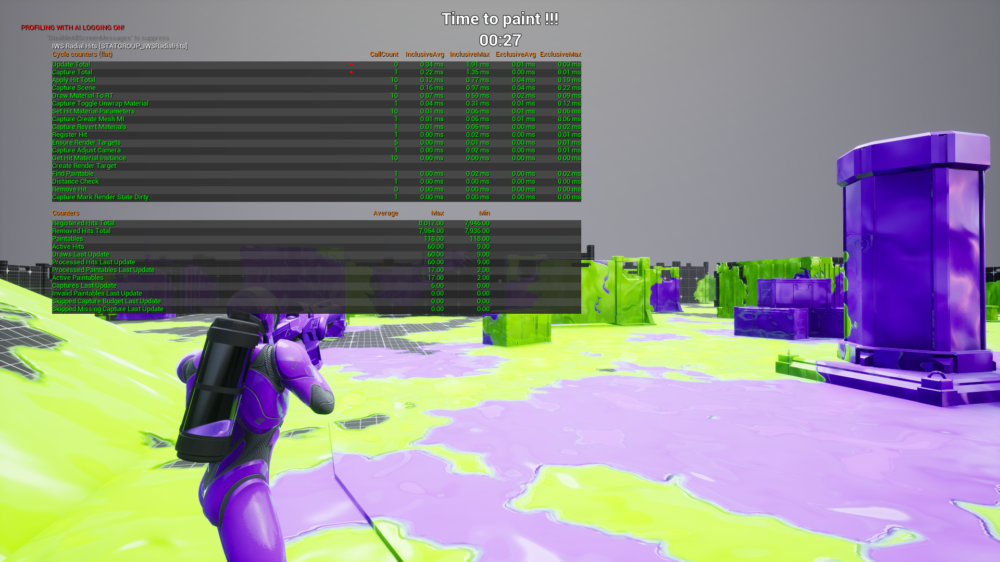

# Optimization and Performance

The optimized C++ paint path exposes performance controls under the `Radial Hits` category and a runtime profiling overlay through Unreal's built-in `stat` system. Use this page to tune the hit update budget, identify expensive steps, and verify whether captures, draws, or hit processing are the current bottleneck.

<p align="center">
  
</p>

## Performance debug overlay

The plugin registers a dedicated Unreal stats group named **IWS Radial Hits**. This is the recommended debug view when profiling paint performance during gameplay.

<p align="center">
  
</p>

Open the in-game console and run:

```text
stat IWSRadialHits
```

To hide the overlay again, run the same command a second time, or use:

```text
stat none
```

The overlay is split into two useful areas:

| Area | What it shows | How to read it |
| --- | --- | --- |
| `Cycle counters` | Timed CPU scopes for each major stage of the radial hit system. | Use `InclusiveAvg` to find the average cost of a stage including nested work. Use `ExclusiveAvg` to see the cost of that stage without children. `Max` values help identify spikes. |
| `Counters` | Runtime counts and budgets from the current paint update flow. | Use these to understand how much work is active, how much work was processed, and whether any budget is delaying captures or draws. |

The stats are reset when the `AIWS_InkHits` actor starts and ends play. This prevents old Play-In-Editor sessions from contaminating a new profiling pass after stopping and starting simulation.

## Average performance group

The plugin also registers a second stats group named **IWS Radial Hits Average**. It stores long-running averages for the same major steps in microseconds, so the values remain useful even when nobody is currently shooting and the regular cycle counters have no fresh calls.

Use this command when you want to evaluate the accumulated average cost of the match/session:

```text
stat IWSRadialHitsAverage
```

The average group is useful for comparing settings because it smooths out short spikes. The values are published as counters named `Average ... us`, where `us` means microseconds. For quick conversion, `1000 us` is `1 ms`.

## Cycle counter reference

| Counter | Meaning | Typical optimization target |
| --- | --- | --- |
| `Update Total` | Full cost of one radial hit update call. | Main number to watch when evaluating the whole system. |
| `Register Hit` | Cost of receiving and registering a new paint hit. | High values usually mean many hits are being registered at once or paintable lookup is expensive. |
| `Distance Check` | Cost of checking whether a hit should animate based on distance. | Usually very small. Enable distance-based optimization when many far hits are active. |
| `Find Paintable` | Cost of finding the paintable mesh/component that received the hit. | High values suggest many paintables or repeated hits on uncached targets. |
| `Ensure Render Targets` | Cost of validating or creating render targets before painting. | Should be low after the first setup pass. |
| `Create Render Target` | Cost of allocating missing render targets. | Expensive if it happens during combat. Prefer preparing paintables before heavy gameplay. |
| `Capture Total` | Full surface capture cost for a paintable. | Usually one of the most important costs. Reduce recaptures when possible. |
| `Capture Adjust Camera` | Cost of positioning/configuring the capture camera. | Usually small. |
| `Capture Create Mesh MI` | Cost of creating or preparing material instances for capture. | Should not happen excessively after setup. |
| `Capture Toggle Unwrap Material` | Cost of switching the mesh to the unwrap/capture material. | Can increase with complex meshes or many material slots. |
| `Capture Mark Render State Dirty` | Cost of forcing the mesh render state to update before capture. | Disable only if captures remain visually correct without it. |
| `Capture Scene` | Cost of the `SceneCaptureComponent2D` capture itself. | Often expensive; reduce capture frequency or capture budget if this spikes. |
| `Capture Revert Materials` | Cost of restoring original materials after capture. | Can increase with many material slots. |
| `Get Hit Material Instance` | Cost of retrieving/preparing the hit material instance. | Should be low unless many dynamic instances are being created. |
| `Apply Hit Total` | Full cost of applying one hit to the render target. | Includes parameter setup and draw work. |
| `Set Hit Material Parameters` | Cost of sending hit data to the material. | Usually small. |
| `Draw Material To RT` | Cost of drawing the hit material into the render target. | One of the main runtime costs when many splashes are active. |
| `Remove Hit` | Cost of removing expired hits from arrays. | High values can happen when many hits expire in the same update. |

## Counter reference

| Counter | Meaning | Tuning note |
| --- | --- | --- |
| `Registered Hits Total` | Total number of hits registered since the current play session started. | Confirms whether shots are reaching the system. |
| `Removed Hits Total` | Total number of hits removed after finishing or being invalidated. | Should increase as animations complete. |
| `Paintables` | Number of paintable mesh entries known by the system. | More paintables can increase lookup/update cost. |
| `Active Hits` | Number of currently active hit animations. | If this climbs too high, reduce animation duration/speed or use distance-based final-frame hits. |
| `Draws Last Update` | Number of draw-to-render-target operations performed in the last update. | Compare against `Max Draws Per Update`. If capped, paint may finish later. |
| `Processed Hits Last Update` | Number of hit entries processed in the last update. | Compare against `Max Hits Per Paintable Per Update`. |
| `Processed Paintables Last Update` | Number of active paintables processed in the last update. | Compare against `Max Paintables Per Update`. |
| `Active Paintables` | Number of paintables currently waiting for hit processing. | If high, increase budgets or reduce hit volume. |
| `Captures Last Update` | Number of surface captures performed in the last update. | Compare against `Max Captures Per Update`. |
| `Invalid Paintables Last Update` | Paintables removed/skipped because their component became invalid. | Should normally stay at `0`. |
| `Skipped Capture Budget Last Update` | Paintables skipped because the capture budget was already used. | Increase `Max Captures Per Update` if captures are delayed too much. |
| `Skipped Missing Capture Last Update` | Paintables skipped because no valid capture was available. | Usually means capture setup failed or was postponed. |

## Optimization variables

| Variable | Description | Performance note |
| --- | --- | --- |
| `Auto Update Radial Hits` | Automatically updates radial hits with a timer. | Disable only if another system calls `Update Radial Hits` manually. |
| `Radial Hits Update Interval` | Time in seconds between automatic updates. `0.016` is close to 60 updates per second. `0.033` is close to 30 updates per second. | Lower values are smoother but more expensive. |
| `Stop Radial Hits Timer when Idle` | Stops the timer when no active hits are waiting to be processed. | Recommended for most projects. Saves CPU when no paint is animating. |
| `Max Paintables Per Update` | Maximum number of paintable meshes processed per update. `0` means no limit. | Use a positive value to spread work across frames. |
| `Max Hits Per Paintable Per Update` | Maximum number of active hits processed for each paintable per update. `0` means no limit. | Useful when many shots hit the same mesh. |
| `Capture Paintable Every Update` | Captures the paintable surface every update before drawing hits. | Safest but expensive. Usually disabled. |
| `Capture Only when Dirty` | Captures only when the paintable is marked dirty or requires a new capture. | Recommended for performance. |
| `Recapture on New Hit` | Marks the target paintable as dirty when a new hit is registered. | Useful when the surface capture must be refreshed before drawing. |
| `Mark Render State Dirty Before Capture` | Forces the mesh render state to update before capture. | Helps avoid stale material/transform data, but has a cost. |
| `Recapture when Transform Changes` | Recaptures when the mesh transform changes beyond the tolerance value. | Enable for moving paintable meshes. Disable for static level geometry. |
| `Transform Recapture Tolerance` | Minimum transform difference required before recapture. | Higher values reduce recaptures on very small movement. |
| `Max Captures Per Update` | Maximum number of surface captures allowed per update. `0` means no limit. | One of the most important performance controls. |
| `Max Draws Per Update` | Maximum number of `Draw Material to Render Target` operations per update. `0` means no limit. | Lower values reduce frame spikes but can delay hit completion. |
| `Use Swap Remove for Expired Hits` | Removes expired hits with swap-remove instead of stable ordered removal. | Faster. Disable only when stable hit order is needed for debugging. |

## Distance variables

| Variable | Description | Performance note |
| --- | --- | --- |
| `Use Distance Based Hit Update` | Uses viewer distance to decide whether a hit should animate normally. | Recommended for gameplay maps with many far impacts. |
| `Full Animation Distance` | Distance within which hits animate normally. | Farther values keep more hits fully animated. |
| `Apply Far Hits as Final Frame` | Far hits are applied directly at their final visual state instead of animating over multiple updates. | Reduces work for distant impacts. |

## Recommended baseline

The demo values used by `BP_IWS_PS_InkHits` are a good baseline for most projects. Start with the demo configuration before tuning.

A common baseline is:

| Setting | Suggested value |
| --- | --- |
| `Auto Update Radial Hits` | Enabled |
| `Radial Hits Update Interval` | `0.016` to `0.033` |
| `Stop Radial Hits Timer when Idle` | Enabled |
| `Capture Paintable Every Update` | Disabled |
| `Capture Only when Dirty` | Enabled |
| `Recapture on New Hit` | Enabled |
| `Max Captures Per Update` | `1` |
| `Max Draws Per Update` | `20` to `60` |
| `Use Distance Based Hit Update` | Enabled |
| `Apply Far Hits as Final Frame` | Enabled |

## Tuning guide

If paint animation is too expensive:

1. Use `stat IWSRadialHits` and check whether the spike comes from `Capture Scene`, `Draw Material To RT`, or `Update Total`.
2. Increase `Radial Hits Update Interval`.
3. Lower `Max Draws Per Update`.
4. Lower `Max Paintables Per Update`.
5. Keep `Capture Paintable Every Update` disabled.
6. Keep `Capture Only when Dirty` enabled.
7. Enable distance-based final-frame hits.

If paint appears delayed:

1. Check `Skipped Capture Budget Last Update`, `Draws Last Update`, and `Processed Hits Last Update` in `stat IWSRadialHits`.
2. Lower `Radial Hits Update Interval`.
3. Increase `Max Draws Per Update`.
4. Increase `Max Hits Per Paintable Per Update`.
5. Increase `Max Paintables Per Update`.
6. Increase `Max Captures Per Update` only if capture budget skips are visible.

If moving meshes paint incorrectly:

1. Enable `Recapture when Transform Changes`.
2. Adjust `Transform Recapture Tolerance`.
3. Keep `Mark Render State Dirty Before Capture` enabled.

## Important performance concept

Surface capture is usually more expensive than simply drawing a hit. For static meshes, avoid recapturing every frame. For moving paintable objects, recapture only when the transform changes enough to matter.
