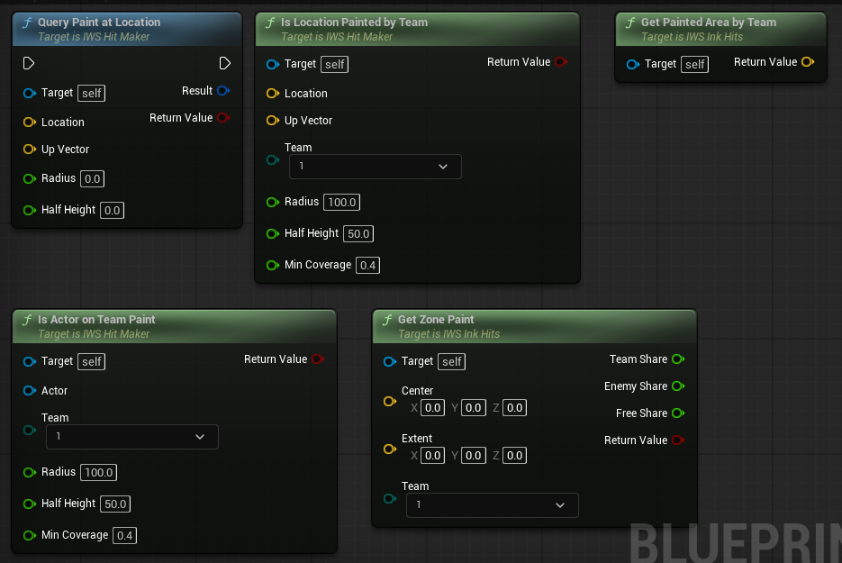
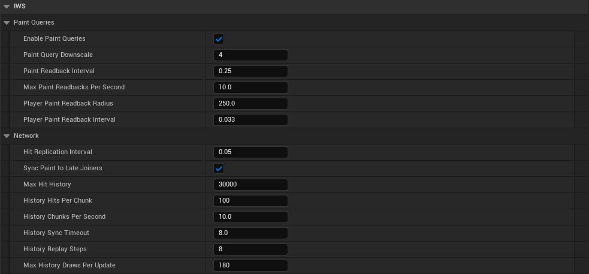

# Paint Queries

New in 2.0. The hit maker keeps a small copy of every paint mask on the CPU, so gameplay code can ask what is painted without touching the GPU. The copy is read from the GPU in the background, a few meshes per second, without stalling the game.

Uses in the demo:

- The player can only swim where its team painted (`Is Actor On Team Paint`).
- Bots pick zones, paint targets and refill spots from the paint.
- Game score and zone score are the painted area of each team.
- The cleaning HUD shows how much dirt is gone.

## Query nodes

  

| Node | What it answers |
| --- | --- |
| `Query Paint At Location` | How much paint of each team is on the surfaces inside a disc. The disc is centered at `Location` and faces `Up Vector`, so it works on floors, walls and ceilings. `Half Height` is how far above and below the disc a surface still counts. Returns false when there is no paintable surface in range. |
| `Is Location Painted By Team` | True when `Team` covers at least `Min Coverage` of the surface inside the disc. |
| `Is Actor On Team Paint` | True when `Team` covers at least `Min Coverage` of the surface under the actor. It follows the actor up vector, so it works while the actor walks on walls. When that misses, it reads the surface a trace finds below the actor and along its gravity, so a swimmer turning onto a wall keeps its paint. |
| `Get Zone Paint` | Share of the floor of a box held by `Team`, by the other teams and still free, from 0 to 1. Walls do not count. |
| `Get Painted Area By Team` | Painted area of each team in cm2. X is team 1, Y team 2, Z team 3. |
| `Get Paintable Surface Area` | Surface area in cm2 of every mesh that has a paint mask. |
| `Find Nearest Team Paint` | The nearest spot painted by `Team` where a pawn can dive, on floors and walls. `Min Up` keeps only surfaces facing up at least that much: `0.7` for floors, `-1` for any surface. |

### `ST_IWS_PaintQueryResult`

| Field | Meaning |
| --- | --- |
| `Found Surface` | True when there is paintable surface inside the queried area. |
| `Surface Area` | Paintable surface inside the area, in cm2, seen along the up vector of the query. |
| `Team 1/2/3 Coverage` | How much of that surface each team covers, from 0 to 1. |
| `Dominant Team` | Team with the largest coverage, or None when the surface is clean. |

## Settings

The settings are in the `IWS|Paint Queries` category of the hit maker.

  

| Variable | Description |
| --- | --- |
| `Enable Paint Queries` | Keeps the CPU copy. Needed by the queries, the bot helpers, `Spill Paint Below` and `Draw Hits In Bounds`. When off, the scores are read from the render targets. |
| `Paint Query Downscale` | How many mask texels each query cell covers per side. `4` means a 1024 mask is kept as 256x256 on the CPU. Larger values use less memory and are less precise. |
| `Paint Readback Interval` | Minimum seconds between two reads of the same mesh. |
| `Max Paint Readbacks Per Second` | Meshes read per second. Meshes closer to the local players are read first. |
| `Player Paint Readback Radius` | The paint this close to each player is read on its own, in a small piece, without waiting for the rest of the mesh. It keeps the queries under the players up to date with paint that just landed. `0` turns it off. |
| `Player Paint Readback Interval` | Minimum seconds between two of those small reads on the same mesh. |

`Get Paint Query Memory Usage MB` returns the memory of the CPU copy.

## How fresh is the answer

A hit shows on screen as soon as it is drawn. The CPU copy follows a few frames later:

- Next to a player, within `Player Paint Readback Radius`, about every `Player Paint Readback Interval` (0.033 s in the demo).
- Elsewhere, when the mesh comes up in the readback queue, every `Paint Readback Interval` at most.

This is fast enough for swimming, AI and scores. For something that must react the same frame a hit lands, listen to the hit in gameplay code instead of querying the paint.

## Scores

`Calculate Game Score` and `Calculate Area Score For Zone` use the CPU copy and weight each mesh by its surface, so a large floor counts more than a small box. The results arrive in `Game Score Result` and `Zone Score Result`.
