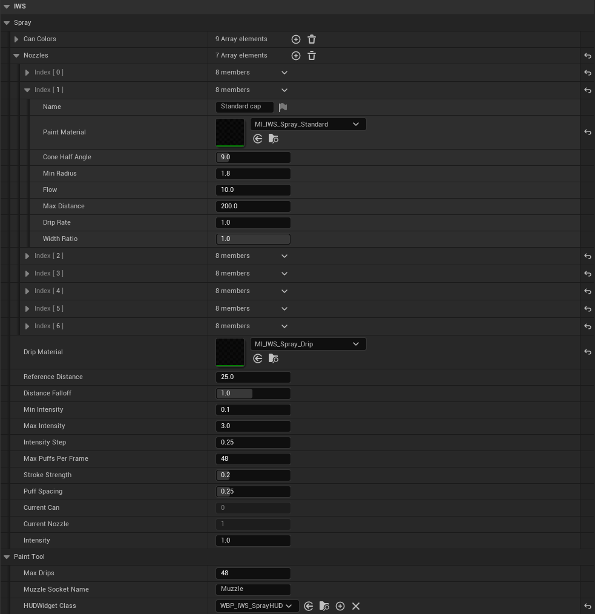
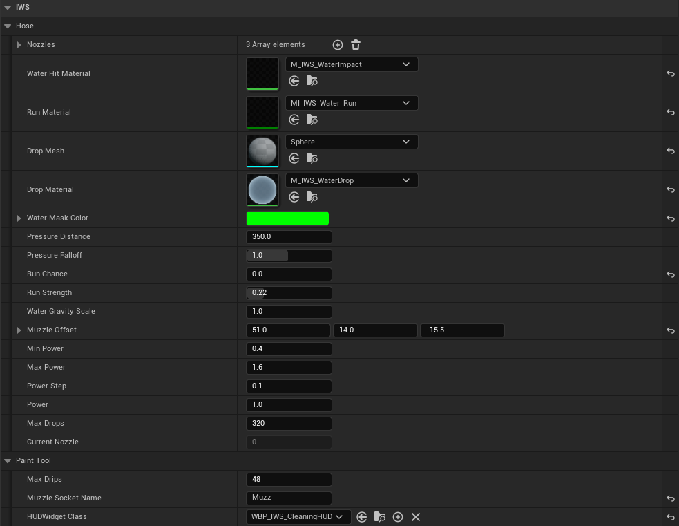
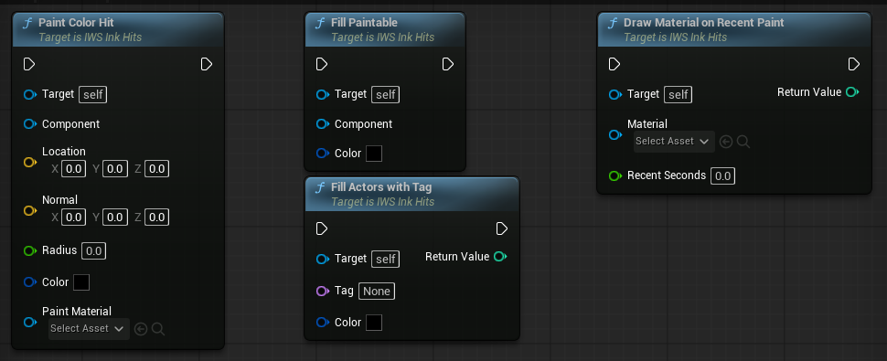
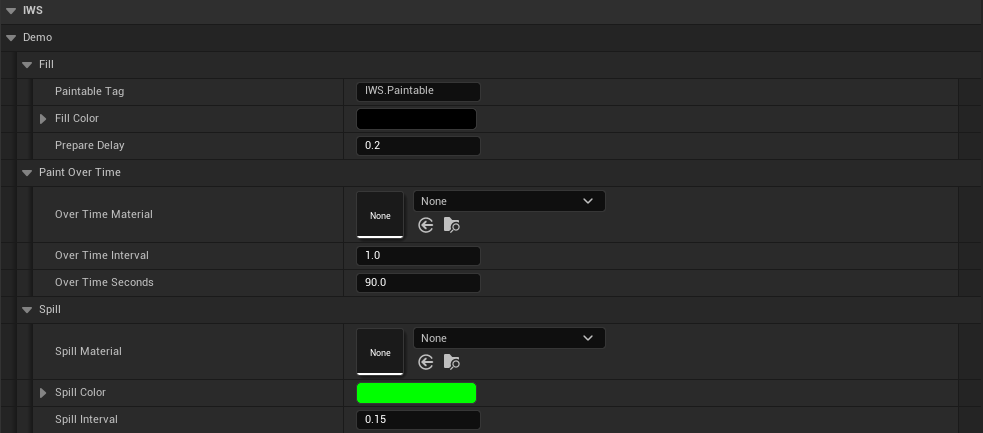

# Paint Tools and Demos

New in 2.0. The paint mask does not have to hold teams. Each texel has four channels, and a project can decide what they mean: a color and its coverage, dirt and water, heat, moss, snow. The spray and cleaning demos show two of these uses with the same hit maker, and the paint tool components make it easy to build more.

## The demos

Open `LVL_IWS_MainMenu`, host, and pick **Spray** or **Cleaning**. Both can also be opened directly. They use `PC_IWS_Demo`, a player controller that gives the pawn game input when the map is opened from the menu.

### Spray (`LVL_IWS_Demo_Spray`)

First person spray cans. Each can has its own color, and the color picker can change it at any time.

| Control | Action |
| --- | --- |
| WASD / mouse | Move and look. |
| Left mouse button | Spray. |
| Mouse wheel | Intensity (how hard the cap is pressed). |
| Up / Down or 1 to 9 | Pick a can. |
| Q / E | Previous / next cap. |
| Tab | Open or close the color picker of the can in use. |
| Space | Jump. |
| F5 / F9 | Save / load the paint of the level. |

**How the colors work.** The spray mask (`BP_IWS_PS_InkHits_Spray`) holds the paint color in RGB and how much paint covers the texel in alpha, instead of one channel per team. Every puff is a color hit (`Paint Color Hit`) drawn by the cap material (`MI_IWS_Spray_*`, children of `M_IWS_ColorImpact`) with the can color, and its strength sets how much it covers. The surface material `M_IWS_ColorPaintSurface` shows the RGB over the base color by the alpha and raises it a little with `MF_IWS_PaintBump`. That is why any color works, without touching `MPC_IWS_TeamColors`. The mask uses `RTF_RGBA16f` and `256` texels per meter for fine lines.

Strokes are even: the paint depends on the distance the can travels, not on the frame rate, and the gaps between frames are filled with puffs. Paint that keeps landing on the same spot of a wall starts to drip.

### Cleaning (`LVL_IWS_Demo_Cleaning`)

A water hose that washes dirty walls and floors.

| Control | Action |
| --- | --- |
| WASD / mouse | Move and look. |
| Left mouse button | Spray water. |
| Mouse wheel | Power (how far the water flies). |
| 1 to 9, Q / E | Pick a nozzle. |
| Space | Jump. |
| F5 / F9 | Save / load the paint of the level. |

**How the water works.** The cleaning mask (`BP_IWS_PS_InkHits_Cleaning`) holds dirt in red, water depth in green and moving water in blue. At the start `BP_IWS_PaintDemoSetup` fills every tagged mesh with dirt. The hose shoots drops that fly in an arc, and each drop that lands writes `Water Mask Color` (no dirt, water) with `M_IWS_WaterImpact`. Over time, `Draw Material On Recent Paint` runs `M_IWS_WaterFlow` on the meshes that got water, which makes it run down walls, spread, wash and dry. `Spill Paint Below` moves the water that reaches the bottom of a wall onto the floor below. The surface material `M_IWS_DirtySurface` shows dirt, wet surfaces and puddles.

## Paint tool components

A paint tool is a component added to a pawn. The component does the traces, the hits and the drips every frame. The Blueprint only says when it is used and with what.

| Component | Use |
| --- | --- |
| `IWS Paint Tool Component` | Abstract base. Make a Blueprint child of it to build a new tool. |
| `IWS Spray Can Component` | Spray cans with colors, caps, intensity and a color picker. |
| `IWS Water Hose Component` | Water hose with nozzles, power, flying drops and running water. |

  

### Base functions and events

| Name | Description |
| --- | --- |
| `Set In Use` | Starts or stops the tool. Call it with the state of the button. Only the player that controls the owner can use it, the state reaches the others by the network. |
| `Is In Use` | True while the tool is used. |
| `Set Aim Component` | Component the tool aims with. Without it, the first camera of the owner is used. |
| `Paint Hit` | Paints one color hit. The alpha of the color is the strength. The hits of a frame are sent together, through the server when needed. |
| `Add Drip` | Starts paint running down from a hit. |
| `Get Aim`, `Get Muzzle Location`, `Has Muzzle Socket` | Where the tool aims from and where the paint leaves it. |
| `Get Hit Maker`, `Get HUD Widget` | The hit maker of the level and the HUD made from `HUD Widget Class`. |
| `Update Tool` (event) | Runs every frame on the machine that controls the owner. A Blueprint tool does its work here. |
| `Update Remote Tool` (event) | Runs every frame on the other machines, for effects and sounds. |
| `Can Use` (event) | Return false while something stops the tool, like a menu. |

Base settings: `Max Drips`, `Muzzle Socket Name` (a socket on any static or skeletal mesh of the owner, placed in the mesh editor) and `HUD Widget Class`.

Helpers in `IWS_DemoLibrary`: `Get Hit Maker`, `Get Paint Tool` (the tool of a class on an actor), and input helpers for demo pawns that do not use input assets: `Get Key Axis`, `Get Pressed Key Axis`, `Get Pressed Number Key`, `Is Key Down`, `Was Key Just Pressed`, `Get Mouse Look`.

### Spray Can Component

  

| Setting | Description |
| --- | --- |
| `Can Colors` | Color of each can. |
| `Nozzles` | Caps (`ST_IWS_SprayNozzle`): name, paint material, cone half angle, min radius, flow, max distance, drip rate and width ratio (flat caps). |
| `Drip Material` | Material of the paint that runs down. |
| `Reference Distance` / `Distance Falloff` | Distance where `Flow` is measured, and how fast paint gets weaker as the mark widens. |
| `Min/Max Intensity`, `Intensity Step`, `Intensity` | Range, wheel step and start value of the intensity. |
| `Max Puffs Per Frame`, `Stroke Strength`, `Puff Spacing` | How strokes are filled between frames. |

Functions: `Select Can`, `Cycle Can`, `Select Nozzle`, `Cycle Nozzle`, `Set Current Can Color`, `Get Current Can Color`, `Get Current Nozzle Name`, `Set Intensity`, `Add Intensity`, `Step Intensity`, `Get Intensity Text`, `Update Can Swatches` (colors the children of a HUD panel with the cans), `Get Spray Preview` (cone, distance and strength for the mist effect), `Set Color Picker Open`, `Toggle Color Picker`. The event `On Can Color Changed` fires on every machine, and `BP_IWS_SprayCharacter` uses it to color the can mesh.

### Water Hose Component

  

| Setting | Description |
| --- | --- |
| `Nozzles` | Nozzle settings (`ST_IWS_HoseNozzle`): name, spread, speed, rate, hit radius and strength. |
| `Water Hit Material` / `Run Material` | Material of each drop mark and of the water that runs down walls. |
| `Drop Mesh` / `Drop Material` | Mesh and material of the drops in the air (instanced, the material needs `Used With Instanced Static Meshes`). |
| `Water Mask Color` | What a drop writes on the mask. The default removes dirt (red 0) and adds water (green 3). A value above 1 needs a float mask. |
| `Pressure Distance` / `Pressure Falloff` | Distance where a drop lands with the nozzle strength and radius, and how much distance changes it. |
| `Run Chance` / `Run Strength` | Chance that a drop on a wall starts water running down, and how much it cleans. |
| `Water Gravity Scale`, `Muzzle Offset` | Gravity of the water and the muzzle without a socket. |
| `Min/Max Power`, `Power Step`, `Power`, `Max Drops` | Power range, wheel step, start value and drops in the air. |

Functions: `Select Nozzle`, `Cycle Nozzle`, `Get Current Nozzle Name`, `Set Power`, `Step Power`, `Get Power Text`, `Get Clean Progress` and `Get Clean Progress Text` (how much of the dirt is gone, from the paint queries).

## Paint functions of the hit maker

  

| Node | Description |
| --- | --- |
| `Paint Color Hit` | Server only. Paints a hit of any color in a single draw, no animation. The alpha of the color is the strength. For masks that hold colors or amounts. |
| `Fill Paintable` | Gives a mesh its mask right away and fills it with a color. |
| `Fill Actors With Tag` | `Fill Paintable` on every static mesh of the actors with a tag. An empty tag takes every actor. |
| `Draw Material On Recent Paint` | Draws a material over the whole mask of every mesh hit in the last `Recent Seconds`. For paint that changes over time, like water that dries. A material with a texture parameter `Mask_Tex` receives a copy of the mask, the unwrap texture and `MaskTexelSize`, so it can move the paint around. |

  

`Spill Paint Below` is server only. Paint that reaches the lower border of a wall lands on the paintable mesh right below it. It reads the blue channel of the CPU copy, where an over time material writes how much paint is moving, and paints one hit below each border cell above `Min Flow`. `Max Drop` is how far below the wall the other mesh can be. Call it a few times per second. It needs `Enable Paint Queries`. `Paint Trail` is described in [Trails, Splats and Drips](TrailsSplatsAndDrips.md).

## Save and load

| Node | Description |
| --- | --- |
| `Save Paint` | Saves the mask of every mesh to a save slot (`IWS_PaintSaveGame`). It reads the masks from the GPU right away, so expect a short pause with many large masks. |
| `Load Paint` | Clears the paint and brings back a slot. Meshes are matched by the names of their actor and component. A mask is skipped when its size or format changed since the save. |
| `Does Paint Save Exist` / `Delete Paint Save` | Check or delete a slot. |
| `On Paint Loaded` (event) | Fires after a load. The tool components listen to it to drop paint that was still on the way. |

Saving works on the machine that calls it. To restore paint for every player in a multiplayer game, load on each machine or send the result with your own logic.

## Paint Demo Setup

`BP_IWS_PaintDemoSetup` is placed in both tool demos and prepares the level.

  

| Variable | Description |
| --- | --- |
| `Paintable Tag` / `Fill Color` / `Prepare Delay` | After the delay, fills every actor with the tag (`IWS.Paintable`) with the color. The cleaning demo fills with dirt. |
| `Over Time Material` / `Over Time Interval` / `Over Time Seconds` | Runs `Draw Material On Recent Paint` with the material every interval, on meshes hit in the last seconds. The cleaning demo uses `M_IWS_WaterFlow`. |
| `Spill Material` / `Spill Color` / `Spill Interval` | Runs `Spill Paint Below` every interval. The cleaning demo uses `M_IWS_WaterImpact` and green (water). |

Empty materials turn a step off. The spray demo only uses the fill.

## Making your own tool

1. Create a Blueprint child of `IWS Paint Tool Component`.
2. Override `Update Tool`: trace from `Get Aim`, then call `Paint Hit` with a color and a paint material.
3. Override `Update Remote Tool` for effects the other players see.
4. Add the component to a pawn and call `Set In Use` from the input.
5. Give the level a hit maker whose mask format fits the values you write, and a surface material that reads them.
