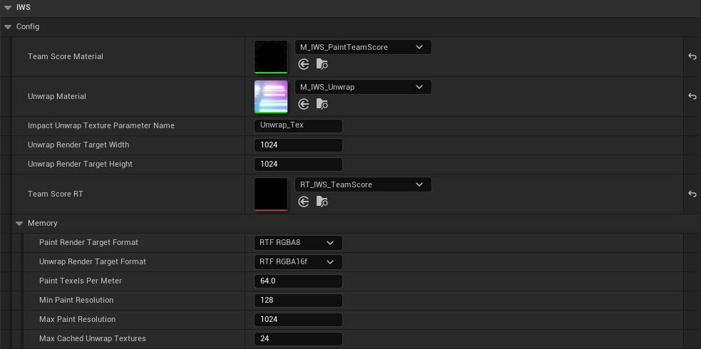

# Painting System Overview

Ink Warfare System uses a render-target based painting workflow. A gameplay hit is converted into a radial paint operation and drawn into a paint mask used by the painted mesh material. A small copy of each mask is read back to the CPU so gameplay code can ask what is painted.

## High-level flow

1. A weapon, projectile, trace, paint tool, or gameplay object generates a hit.
2. The gameplay object calls `IWS Receive Impact` on the hit maker (`IWS_InkHits`).
3. The server turns the hit into a compact network hit and sends it to every client in a batch.
4. Each machine registers the hit on the mesh it landed on and grows it over a few updates.
5. The mesh unwrap (world position of each texel) is captured once per static mesh and reused.
6. The selected paint material draws the hit into the paint mask of the mesh, only on the area it can reach.
7. The painted mesh material reads the mask and shows the final paint.
8. A downscaled copy of the mask is read back to the CPU over the next frames, for paint queries and scores.

## Important data passed by an impact

| Field | Purpose |
| --- | --- |
| `Hit Result` | Provides the hit component, impact point and impact normal. |
| `Size` | Radial hit size range. The system interpolates the radius during the hit animation. |
| `Intensity` | Initial strength of the impact. Usually between `0.0` and `1.0`. |
| `Speed` | How quickly the hit animation progresses. Higher values finish faster. |
| `Team` | Team that owns the paint. Team 1, 2 and 3 are the red, green and blue channels of the mask. |
| `Paint Material` | Material used to draw this impact into the mask. |

## Paint material

The paint material is passed through `IWS Receive Impact`. Different weapons, projectiles or effects can use different paint visuals with the same hit-processing system.

The C++ pipeline sets these parameters on the paint material:

| Parameter | Purpose |
| --- | --- |
| `Unwrap_Tex` (or the configured unwrap texture parameter name) | Position of each texel of the mesh, relative to the mesh. |
| `UnwrapOrigin` | Origin that turns the unwrap position into a world position: `Unwrap_Tex + UnwrapOrigin`. |
| `UnwrapTexelOffset` | Size of two unwrap texels in UV units, for materials that sample the unwrap around a texel. |
| `Color` | Team color of the hit, or the custom color of a color hit. |
| `Intensity` | Runtime strength of the hit. |
| `Radius` | Runtime radius of the hit. |
| `Position` | World-space hit position. |
| `Normal` | World-space hit normal. |

The default parameter name for the unwrap texture is controlled by `Impact Unwrap Texture Parameter Name` in the `IWS|Config` category. `M_IWS_RadialImpact` is the simplest reference, `M_IWS_InkImpact` is the battle splat and `M_IWS_ColorImpact` is the spray.

> **From 1.x:** unwrap positions are now relative to the mesh to keep precision far from the world origin. A custom paint material must add `UnwrapOrigin` to the value read from `Unwrap_Tex`.

## Paint masks and memory

Each paintable mesh gets its own paint mask, sized from its surface area: `Paint Texels Per Meter` texels per meter, clamped between `Min Paint Resolution` and `Max Paint Resolution`. Small props use small textures, large floors get more texels. The default format is `RTF_RGBA8`.

The unwrap texture of a mesh that does not move is captured once and kept in a small cache. Only `Max Cached Unwrap Textures` stay in memory at once: meshes that were not hit recently give theirs back to a pool and capture again on their next hit. A mesh that moves is captured again when its transform changes (`Recapture When Transform Changes`).

  

`Get Paint Memory Usage MB`, `Get Paint Render Target Count` and `Compute Paint Resolution` return the current numbers. The `stat IWSRadialHits` overlay and the `iws.Perf` report show them too.

## Meshes left out of the paint

Actors and components with the tag in `No Paint Tag` (default `IWS.NoPaint`) are left out: hits on them are ignored and they never get a paint mask. Add the tag to the actor `Tags` or to the `Component Tags` of a single mesh. `Can Paint Component` tells whether a mesh can be painted.

## Config category

The `IWS|Config` category usually does not need to diverge much from the values used by `BP_IWS_PS_InkHits`. Change it when a project needs a different unwrap resolution, mask format, memory budget or material parameter name.

## Scoring

Game score (`Calculate Game Score`) and zone score (`Calculate Area Score For Zone`) read the CPU copy of the paint and weight it by painted area. The results arrive in the `Game Score Result` and `Zone Score Result` events. With `Enable Paint Queries` off, the scores go back to reading the render targets. The exact scoring rules can be adapted by the game mode.

## Mesh and material requirements

For custom assets, the default paint workflow expects a supported Static Mesh with UV channel 1. UV channel 1 is used as the unwrap channel for the paint data. This is also what allows a mesh with multiple material slots to share a single paint mask.

The visible material should use the Ink Warfare material function, or an equivalent setup that keeps the expected `RT_Damage` render target parameter and samples it with UV channel 1.

For detailed setup, see:

- [Mesh Setup](MeshSetup.md)
- [Material Setup](MaterialSetup.md)
- [Paint Queries](PaintQueries.md)
- [Networking](Networking.md)
