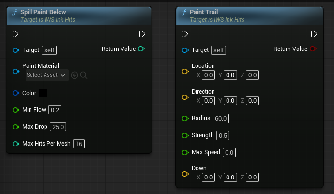
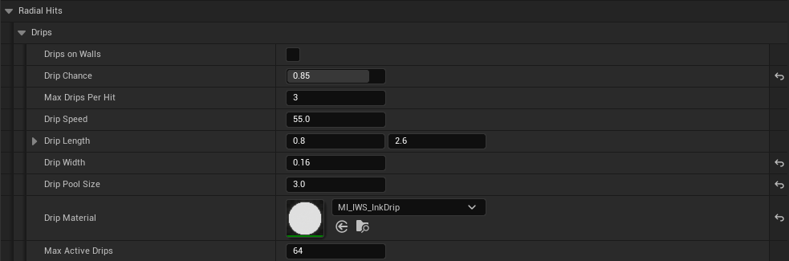

# Trails, Splats and Drips

Visual details of the ink battle that were added in 2.0. None of them change the score or the gameplay paint, and none of them cost network traffic.

## Splats

The battle splat is `MI_IWS_InkImpact` (parent `M_IWS_InkImpact`). It shapes thick paint in 3D around the impact point: a body with a noisy edge, and droplets thrown around it. The shape is revealed as the hit grows, so a splat looks like it lands instead of scaling up.

Because the shape lives in world space, the same splat continues over corners. The demo bullet sends the impact to every mesh in a sphere around the landing point (see [IWS Receive Impact](IWSReceiveImpact.md#recommended-usage-pattern)), so a shot near a corner paints both sides.

Main parameters of `M_IWS_InkImpact`:

| Parameter | Effect |
| --- | --- |
| `Softness` | Softness of the border. |
| `EdgeAmount` / `NoiseScale` | How noisy the edge is and the size of the noise. |
| `DropAmount` / `DropletSize` | How many droplets and their size. |
| `DropRadiusMin/Max`, `DropDistanceMin/Max` | Size and distance range of the droplets, relative to the hit. |
| `MaxRadius` | Furthest the shape reaches, in hit radius. |

The material skips its work for texels farther than the body and droplets can reach. If a custom splat reaches further than its radius and looks cut, raise `Hit Bounds Scale` on the hit maker.

## Swim trails

A swimming player pushes the paint down and leaves a wake. The waves spread over the paint up to a few times the size of the swimmer, then slow down and set in place. New paint covers old trails with the shape of the hit. Trails also follow walls, since they use the gravity of the swimmer.

Trails are kept in their own texture on each mesh, `RT_Trail`, read by the surface material through `MF_IWS_WaveNormal`. Red is the height of the paint, green its height one step before, blue how soft it still is. They never touch the paint mask or the score.

  

`Paint Trail` pushes the paint under a location. It is local: call it on every machine for each pawn that swims. The demo player does it while swimming.

| Input | Description |
| --- | --- |
| `Location` | Where the swimmer is. |
| `Direction` | Velocity of the swimmer. |
| `Radius` / `Strength` | Size and depth of the push. |
| `Max Speed` | Top speed of the swimmer. The faster it goes, the further the waves reach (see `Trail Wave Size`). `0` always uses the furthest reach. |
| `Down` | Direction from the location to the surface, the gravity of the swimmer. Zero is straight down. |

Settings in `IWS|Paint System|Trail` (picture in [Ink Hits Classes](InkHitsClasses.md)):

| Variable | Description |
| --- | --- |
| `Trail Material` / `Trail Wave Material` | Material that pushes the paint (`MI_IWS_InkTrail`) and material that moves the waves one step (`MI_IWS_InkTrailWaves`). |
| `Trail Wave Size` | How far waves reach, in sizes of the swimmer: X standing still, Y at top speed. |
| `Trail Wave Speed` | How fast waves spread, in cm per second. |
| `Trail Wave Damping` | Part of the wave speed left after one second. Lower is thicker paint. |
| `Trail Wave Seconds` | Time the paint takes to set after a swimmer moved it. |
| `Paint Clears Trails` | New paint covers the trails under it once the hit reaches its final size. |
| `Max Trail Wave Steps` | Most wave steps of one trail texture per update. |
| `Trail Texels Per Meter` / `Max Trail Resolution` | Size of the trail texture of each mesh. |
| `Trail Trace Distance` | How far from the location, along `Down`, the surface can be. |

In the surface material, `Trail Depth` sets how deep the waves look and `Trail Max Slope` limits how far a wave can tilt the surface normal.

## Drips

With `Drips On Walls`, team paint that lands on a wall runs down over time and lands on what is below. Every machine runs the drips by itself from the same hits. It is off in the demo.

  

| Variable | Description |
| --- | --- |
| `Drips On Walls` | Turns drips on. |
| `Drip Chance` | Chance that a hit on a wall drips. |
| `Max Drips Per Hit` | Most drips one hit can start. |
| `Drip Speed` | How fast the paint runs down, in cm per second. |
| `Drip Length` | Shortest and longest run, in radius of the hit. |
| `Drip Width` | Radius of a drip, in radius of the hit. |
| `Drip Pool Size` | Size of the paint a drip leaves where it lands on a floor. `0` leaves none. |
| `Drip Material` | Material of the drips. Empty uses the material of the hit. |
| `Max Active Drips` | Most drips running at the same time. |

The spray can has its own drips, from paint that keeps landing on the same spot (`Drip Material` and `Drip Rate` of each cap).
